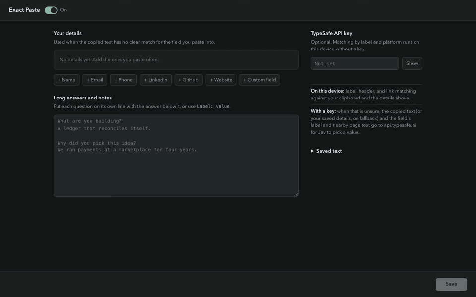

# Exact Paste

Copy a whole application draft once. Paste into each form field, and Exact Paste picks the answer under its matching header. Save your LinkedIn URL, email, phone, and other details in the popup for fields your clipboard doesn't cover.

Answers come from your copied text or saved details. Exact Paste writes only the box you paste into and never submits the form. Unclear matches fall back to the copied text or leave an existing value alone.

[](docs/exact-paste-demo.mp4)

[Watch or download the video](docs/exact-paste-demo.mp4). It shows the real Chrome extension, saved details, one copied application draft, and individual pastes. No API key is used.

## Install in Chrome

No API key or Node installation is needed for the prebuilt extension.

1. Download **exact-paste.zip** from [the latest release](https://github.com/goodnight000/exact-paste/releases/latest).
2. Unzip it somewhere you will keep, such as your Documents folder. The extracted folder is named `exact-paste`.
3. Open `chrome://extensions` in Chrome. Turn on **Developer mode** at the top right.
4. Click **Load unpacked** and select the extracted `exact-paste` folder. Select the folder that contains `manifest.json`.
5. Reload any form tabs that were already open. In Chrome's extensions menu, pin **Exact Paste**.
6. Click Exact Paste. Add LinkedIn, email, or a custom field and click **Save**.

Chrome requires the Load unpacked step. Keep the extracted folder in place. This is a desktop Chrome extension, not a Chrome Web Store installation.

To update, extract the newer release into that folder, then click the extension's reload button in `chrome://extensions`. Saved details stay in Chrome's extension storage. Removing the extension clears them.

### Build from source

You need [Node 22.15+](https://nodejs.org) and Git:

```sh
git clone https://github.com/goodnight000/exact-paste.git
cd exact-paste
npm ci
npm start
```

The setup prints the exact `dist` folder to load and opens Chrome's installer and the folder on macOS. On Windows, it opens the folder; open `chrome://extensions` yourself. On Linux, it tries the installed Chrome or Chromium.

On macOS or Linux, the existing one-command installer also works:

```sh
curl -fsSL https://raw.githubusercontent.com/goodnight000/exact-paste/main/install.sh | bash
```

That installs into `~/.exact-paste`. It stops if an existing checkout has local changes. `npm start -- --no-open` builds and prints the steps without opening apps.

## Paste an application draft

Use the form's question as the header. Markdown headings are the clearest way to separate long answers:

```text
LinkedIn URL: https://www.linkedin.com/in/you
Email: you@example.com

## What are you building?
We are building a scheduling tool for clinics.

This second paragraph belongs to the same answer.

## Why did you pick this idea?
We ran a clinic and spent hours fixing scheduling mistakes.
```

Copy the entire draft. Click the LinkedIn box and paste. Click "What are you building?" and paste again from the same clipboard. Each field gets its own value, including the complete multiline answer.

`Label: value`, standalone headers, bold headers, and numbered question headings also work. Common aliases such as "LinkedIn" / "LinkedIn URL" and "Email" / "Email address" match. Personal and work fields stay distinct. Use a deeper Markdown heading for a subheading inside an answer, and fenced code blocks for literal template syntax.

Local header matching scans the complete clipboard, including headers after the first 12,000 characters. Conflicting duplicate answers are ambiguous. Exact Paste keeps the copied text instead of guessing or substituting a saved answer. It refuses to shorten a matched answer or URL to fit a field's character limit.

### Saved details

The popup has presets and custom fields with your own labels and multiline values. **Open full page** gives more room. **Save** applies changes; unsaved drafts survive closing the popup during the current browser session. Drafts are not active until saved.

A matching clipboard answer wins. Saved details are used when the clipboard has no clear match. A standalone essay pasted into a textarea stays your copied essay. A headed application missing one question can use that question's saved answer when other headers match nearby form fields.

Shift+paste (`Cmd+Shift+V` / `Ctrl+Shift+V`) bypasses Exact Paste. Turn it off in the popup or with `Alt+Shift+V` for normal pasting. Its badge shows **OFF**.

### Optional Jev matching

[TypeSafe Jev](https://www.typesafe.ai/) helps when local matching is unsure. Add a [TypeSafe API key](https://console.typesafe.ai/settings/keys) in Settings and click **Save**. The model remains `jev-1.13.0`.

Jev chooses a candidate substring, then verifies it. Confidence, shape, platform, and exact-source checks run in code. Errors and timeouts fall back safely. Ambiguous documents longer than 12,000 characters stay local; they are never truncated to a prefix for a model guess.

A build is key-free by default. `npm run package` produces `release/exact-paste.zip` and always excludes the environment or `.env` key. For a personal build only, `npm run build -- --with-key` can include `TYPESAFE_API_KEY`. Never share that personal `dist` folder.

## Try the demos

From a checkout:

```sh
npm run demo
```

Open [the application demo](http://127.0.0.1:4173/application.html). It includes a complete draft, multiline questions, and fields that use saved details. Other [demo scenes](http://127.0.0.1:4173/) cover addresses, invoices, names, vendors, and links.

## Supported fields and limits

Exact Paste handles labelled text, email, phone, and URL inputs, plus labelled application textareas. It handles open shadow roots and matching website frames, including frames created by a matching page. It uses the native value setter and input/change events so frameworks can observe a paste.

Password, payment, verification-code, search, comment, and chat fields use normal paste. Numeric/date controls, rich-text editors, closed shadow roots, native apps, Chrome's internal pages, and pages with no readable field label are outside smart-paste support. Site-specific input masks or editors may need additional fixtures. Exact Paste cannot guarantee a match on every website.

If you type, move the cursor, switch fields, turn the extension off, or start another paste while a decision is pending, the old reply cannot overwrite that work. A worker deadline bounds the wait. Browser-native line-ending normalization still applies.

## Privacy

Exact Paste reads clipboard text only during a genuine user paste. It does not monitor copies or keep clipboard history. Web pages cannot synthesize a paste to retrieve saved details.

Saved details and keys live in Chrome's local extension storage. They are not encrypted by Exact Paste, so save only details you intend to paste into websites. Unsaved drafts use Chrome's session storage and disappear when the browser session ends.

Without a key, matching stays on the device. With a key, unresolved clipboard text or fallback notes, field metadata, and nearby field labels may go to `api.typesafe.ai`. Structured saved fields are matched locally. Recognized private keys, access tokens, and card-shaped numbers block model requests; this check is not a complete sensitive-data detector. The extension does not send the key to the page.

## Development and checks

```sh
npm test             # local regressions, no API calls
npm run typecheck
npm run package      # key-free ZIP
npm run verify       # real Chrome extension and native clipboard checks
```

Browser verification uses a temporary Chrome profile. Set `CHROME_PATH` if Chrome is installed elsewhere. `npm run verify -- --headed` shows its browser. Tests cover huge templates, duplicate/conflicting headers, platform URLs, race protection, native fallback, and synthetic-paste privacy.

`npm run eval` calls live Jev and requires `TYPESAFE_API_KEY`. It reports exact matches, safe misses, and unsafe slices; any unsafe slice fails. The local tests and README recording do not establish live Jev accuracy.

To recreate the screen recording, run `npm run build` then `npm run record-demo`. This needs Chrome and FFmpeg. It records fictional sample details and the actual extension, without a model call.

MIT. See [SPEC.md](SPEC.md) for the contract and [CONTRIBUTING.md](CONTRIBUTING.md) for fixture guidance.
