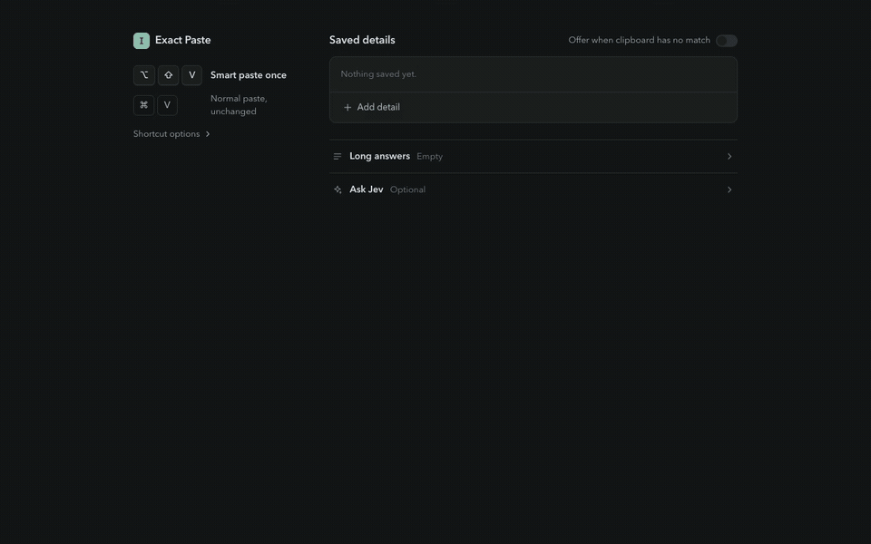

# Exact Paste

Copy a whole application draft once. Press **Option+Shift+V** on Mac or **Alt+Shift+V** on Windows and Linux in each form field. Exact Paste inserts the answer under its matching header. **Cmd+V / Ctrl+V stays normal.** There is no mode to turn on or off.

Exact clipboard headers can paste immediately. Inferred matches and optional saved details wait for your choice. Smart paste replaces only the selection, or inserts at the cursor; Chrome's undo works. It never submits the form. An uncertain match offers candidates and **Paste original**.

[](docs/exact-paste-demo-v0.4.mp4)

[Watch or download the video](docs/exact-paste-demo-v0.4.mp4). It shows normal paste and undo, the real smart-paste shortcut, one copied draft, and confirmation before inserting saved details. No API key is used.

## Install in Chrome

No API key or Node installation is needed for the prebuilt extension.

The Chrome Web Store release is being prepared and is not yet available for store installation. Use the downloadable extension below until a reviewed listing is live.

1. Download **exact-paste.zip** from [the latest release](https://github.com/goodnight000/exact-paste/releases/latest).
2. Unzip it somewhere you will keep, such as your Documents folder. The extracted folder is named `exact-paste`.
3. Open `chrome://extensions` in Chrome. Turn on **Developer mode** at the top right.
4. Click **Load unpacked** and select the extracted `exact-paste` folder. Select the folder that contains `manifest.json`.
5. The first-run practice page opens automatically. Copy its sample and try both normal paste and smart paste. You can reopen the tutorial from the popup.
6. Reload any form tabs that were already open. In Chrome's extensions menu, pin **Exact Paste**.
7. Click Exact Paste to see your assigned shortcut. Saved details are optional; enable **Offer when clipboard has no match** and click **Save** if you want them suggested.

Chrome requires the Load unpacked step. Keep the extracted folder in place. This is a desktop Chrome extension, not a Chrome Web Store installation.

To update, extract the newer release into that folder, then click the extension's reload button in `chrome://extensions`. Saved details stay in Chrome's extension storage. Removing the extension clears them.

### Build from source

You need [Node 22.15+](https://nodejs.org) and Git:

```sh
git clone https://github.com/goodnight000/exact-paste.git
cd exact-paste
npm ci
npm start
```

The setup prints the exact `dist` folder to load and opens Chrome's installer and the folder on macOS. On Windows, it opens the folder; open `chrome://extensions` yourself. On Linux, it tries the installed Chrome or Chromium.

On macOS or Linux, the existing one-command installer also works:

```sh
curl -fsSL https://raw.githubusercontent.com/goodnight000/exact-paste/main/install.sh | bash
```

That installs into `~/.exact-paste`. It stops if an existing checkout has local changes. `npm start -- --no-open` builds and prints the steps without opening apps.

## Paste an application draft

Use the form's question as the header. Markdown headings are the clearest way to separate long answers:

```text
LinkedIn URL: https://www.linkedin.com/in/you
Email: you@example.com

## What are you building?
We are building a scheduling tool for clinics.

This second paragraph belongs to the same answer.

## Why did you pick this idea?
We ran a clinic and spent hours fixing scheduling mistakes.
```

Copy the entire draft. Click the LinkedIn box and press the smart-paste shortcut. Click "What are you building?" and use the same shortcut again. Each field gets its own value, including the complete multiline answer.

`Label: value`, standalone headers, bold headers, and numbered question headings also work. Common aliases such as "LinkedIn" / "LinkedIn URL" and "Email" / "Email address" match. Personal and work fields stay distinct. Use a deeper Markdown heading for a subheading inside an answer, and fenced code blocks for literal template syntax.

Local header matching scans the complete clipboard, including headers after the first 12,000 characters. Conflicting duplicate answers are ambiguous. Exact Paste keeps the copied text instead of guessing or substituting a saved answer. It refuses to shorten a matched answer or URL to fit a field's character limit.

### Saved details

Choose **Add detail** in the popup for presets or custom fields with your own labels and multiline values. The expand icon opens the full settings page. Long answers and optional AI settings are collapsed until you need them. **Save** applies changes; unsaved drafts survive closing the popup during the current browser session. Drafts are not active until saved.

A matching clipboard answer wins. Saved details are disabled by default; enable **Offer when clipboard has no match** to offer a missing answer. Choose **Use saved detail** before it is inserted. Saved values are not displayed on the website before that choice. This also works with an empty clipboard. Ordinary paste always preserves your copied essay. During smart paste, a missing textarea answer can be offered only when another nonempty clipboard header matches a nearby field.

**Cmd+V / Ctrl+V** and **Cmd+Shift+V / Ctrl+Shift+V** are always Chrome's native paste. **Option/Alt+Shift+V** smart pastes once. There is no mode toggle. **Shortcut options** contains the disable switch and **Change shortcut**, which opens Chrome's shortcut settings. Chrome's extension site-access controls can disable Exact Paste on specific websites.

### Optional Jev matching

[TypeSafe Jev](https://www.typesafe.ai/) can suggest a match when local matching is unsure. Nothing is sent automatically: choose **Ask Jev** to send that clipboard and field information to TypeSafe. Its proposed value still requires confirmation. Add a [TypeSafe API key](https://console.typesafe.ai/settings/keys) in Settings and click **Save**. The model remains `jev-1.13.0`.

Jev chooses a candidate substring, then verifies it. Confidence, shape, platform, and exact-source checks run in code. Errors and timeouts leave the field unchanged and offer Paste original. Ambiguous documents longer than 12,000 characters stay local; they are never truncated to a prefix for a model guess.

A build is key-free by default. `release/exact-paste-store.zip` is the separate store upload, with `manifest.json` at its root. `npm run package` produces `release/exact-paste.zip` and always excludes the environment or `.env` key. For a personal build only, `npm run build -- --with-key` can include `TYPESAFE_API_KEY`. Never share that personal `dist` folder.

## Try the demos

From a checkout:

```sh
npm run demo
```

Open http://127.0.0.1:4173. Each scene is a desktop: the app you copy from on the left, the web app you paste into on the right. Click the source (one click selects it), copy, then use the smart-paste shortcut in one field at a time. Heuristic scenes require choosing a proposed value.

| Scene | What it shows |
| --- | --- |
| [Ship](http://127.0.0.1:4173/keel.html) | Mail to a shipping label. One address. Street, city, ZIP, country. |
| [Vendor](http://127.0.0.1:4173/vendor.html) | Team chat to a vendor record. Two people. Takes the electrician Dave said to use, not the other. |
| [Bill](http://127.0.0.1:4173/bill.html) | PDF invoice to accounts payable. Invoice number, amount, due date, remit address. |
| [Guest](http://127.0.0.1:4173/guest.html) | Text thread to a reservation. First name / last name from `Maya Chen`. Dietary notes stays a normal paste. |
| [Links](http://127.0.0.1:4173/links.html) | Doc to show notes. Three URLs. Site vs GitHub vs LinkedIn. |
| [Application](http://127.0.0.1:4173/application.html) | An answer draft to an application form. Each question box gets its section; name, phone, GitHub come from saved details. |
| [Apply](http://127.0.0.1:4173/apply.html) | The vault. A job application filled with nothing useful on the clipboard. |

[docs/DEMO.md](./docs/DEMO.md) is the new recording script. `npm run rehearse` checks the key-free application workflow in real Chrome and must end with `ALL_OK`. Historical live-Jev scene results are not a claim about this version.

## Supported fields and limits

Exact Paste handles labelled text, email, phone, and URL inputs, plus labelled application textareas. It handles open shadow roots and matching website frames, including frames created by a matching page. Smart insertion uses Chrome's native editing command for selection and undo. Ordinary paste keeps native site paste/beforeinput handling. Smart compatibility with a particular site is not guaranteed.

Password, payment, verification-code, search, comment, and chat fields use normal paste. Numeric/date controls, rich-text editors, closed shadow roots, native apps, Chrome's internal pages, and pages with no readable field label are outside smart-paste support. Site-specific input masks or editors may need additional fixtures. Exact Paste cannot guarantee a match on every website.

If you type, move the cursor, switch fields, disable the shortcut, or invoke it again while a decision is pending, the old reply cannot overwrite that work. Cancellation is visible. Smart clipboard reading needs HTTPS or localhost; use normal paste on insecure HTTP pages. International formats are not converted automatically, and uncertain name parts are not split. A worker deadline bounds the wait. Browser-native line-ending normalization still applies.

## Privacy

Exact Paste reads clipboard text only when you invoke its smart-paste shortcut. The clipboard permission is needed for that explicit action. It does not monitor copies or keep clipboard history. Web pages cannot synthesize a paste to retrieve saved details.

Saved details and keys live in Chrome's local extension storage. They are not encrypted by Exact Paste, so save only details you intend to paste into websites. Unsaved drafts use Chrome's session storage and disappear when the browser session ends.

Without a key, matching stays on the device. With a key, **choosing Ask Jev** sends unresolved clipboard text or enabled fallback notes, field metadata, and nearby field labels to `api.typesafe.ai`. Structured saved fields are matched locally. Recognized private keys, access tokens, and card-shaped numbers block model requests; this check is not a complete sensitive-data detector. The extension does not send the key to the page.

## Development and checks

```sh
npm test             # local regressions, no API calls
npm run typecheck
npm run package      # key-free download and store ZIPs
npm run verify       # real Chrome extension and native clipboard checks
npm run rehearse     # key-free browser/demo rehearsal
```

Browser verification uses a temporary Chrome profile. Set `CHROME_PATH` if Chrome is installed elsewhere. `npm run verify -- --headed` shows its browser. Tests cover huge templates, duplicate/conflicting headers, platform URLs, race protection, native fallback, and synthetic-paste privacy.

`npm run eval` calls live Jev and requires `TYPESAFE_API_KEY`. It reports exact matches, safe misses, and unsafe slices; any unsafe slice fails. The local tests and README recording do not establish live Jev accuracy.

To recreate the screen recording, run `npm run build` then `npm run record-demo`. This needs Chrome and FFmpeg. It records fictional sample details and the actual extension, without a model call.

MIT. See [SPEC.md](./SPEC.md) for the contract, [docs/HOW-IT-WORKS.md](./docs/HOW-IT-WORKS.md) for how the code implements it, and [CONTRIBUTING.md](./CONTRIBUTING.md) to add fixtures.

Store preparation and permission wording: [docs/STORE.md](./docs/STORE.md). Privacy policy: [docs/PRIVACY.md](./docs/PRIVACY.md). A public store listing requires a developer account and Google review; the local ZIP is not a store publication.
